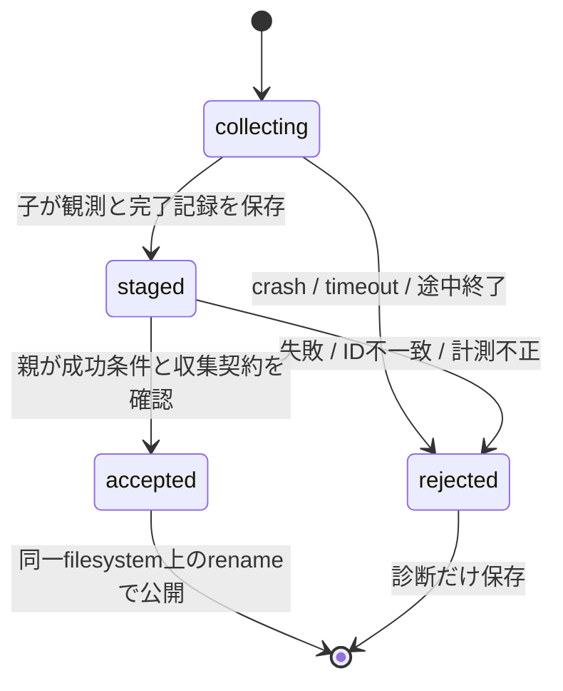

# 成功した基準実行の分岐観測（#18）

状態: 提案。収集器は未実装。この文書だけでは [#18](https://github.com/s4na/sukashi/issues/18) を完了しない。

## 最初に何を作るか

基準コミットの全件実行から、テスト ID ごとの「実際に通った Ruby 分岐」を記録する。
最初の実装は一つの Ruby プロセス内で逐次実行する RSpec と Minitest に限定する。
既存の静的解析や終了コードを変えず、観測履歴だけを理由にテストを省かない。

実測と静的推論を混ぜないことが重要になる。現行 Planner の到達 ID は静的解析の結果であり、
未観測のテストが変更の影響を受けない証拠ではない。
履歴を使う場合の集合は「現行の静的候補 ∪ 観測で関連した候補」とする。
現行判断が full の場合は full のまま。履歴が不明なら現行判断をそのまま使う。

まず収集専用の小さな実装を作る。plan への読み込み、並列 worker の統合、
成功結果の再利用、enforce モードは別段階とする。

## 既存コードとの接続

Runner は既に子プロセスを起動し、RSpec と Minitest の ID・結果を読み取っている。
ただし RSpecInventory は dry-run 用、Minitest の Reporter は終了結果用であり、
どちらも現在は実行区間の coverage を記録しない。

提案する追加部分は次の三つだけとする。

| 部分 | 責務 |
| --- | --- |
| 観測 bootstrap / collector | アプリ読込み前に Coverage を開始し、テスト区間の差分を収集する |
| RSpec / Minitest adapter | ID、実行区間、最終結果を collector に渡す |
| 親側 artifact validator | 子の終了と inventory を照合し、成功 artifact を確定する |

既存の plan JSON とテスト結果 JSON は変更しない。観測ファイルは専用ディレクトリへ出し、
Runner の既存 `*.json` 結果読込みに混ぜない。
最初の入口は開発用の収集 API と Actions fixture とし、利用者向け CLI の公開は検証後に決める。

## 収集区間

1. 親は clean な基準 commit、job 設定、seed と discover の ID 集合を確定する。
2. 子に専用 bootstrap を先に読み込ませる。RSpec の通常の `--require` だけに頼らず、
   Rails や application helper より前に `Coverage.start(lines: true, branches: true)` を呼ぶ。
   既に Coverage が開始済みなら停止・clear・再設定せず、競合として収集を拒否する。
3. 各テストの setup 前と teardown 後に `Coverage.peek_result` を取得する。
   同じファイル・分岐キーの counter 差が正のものを観測とする。
   同じ行に then/else があっても line coverage だけで区別しない。
4. RSpec は example lifecycle 全体を包み、Minitest は標準 Test#run 全体を包む。
   reporter で確定した結果と ID を後で結び付ける。skip、失敗、例外も個別に記録する。
   framework/version ごとの hook 順序と独自 run override は Actions で検証し、
   包み込みを保証できない protocol は未対応とする。
5. suite/context hook や boot のようにテスト一件へ帰属できない区間は共通依存として分離する。
   before(:all) を最初の example だけの依存として扱わない。
6. 子は一時 artifact と完了記録を書き、親が process status と既存結果を照合する。
   子の at_exit が動いたことだけでは成功確定しない。

計測中に clear、counter の減少、再設定、重複・入れ子のテスト区間を検出したら invalid とする。
peek の前後差分は実行順序や呼出し stack を表すものではない。

## 成功 artifact の確定境界

成功と収集範囲の完全性は別の軸で保存する。
初版の範囲は `project_ruby_single_process`。
この名前はプロジェクト内 Ruby の当該プロセスでの観測を指し、
gem、テンプレート、native code、外部サービスまで完全に追跡したことを意味しない。

親が次の条件をすべて確認した run だけを `accepted` とする。

- 基準 commit と設定 fingerprint が実行前後で一致し、対象ソースに変更がない。
- discover と終了結果の ID 集合が一致し、重複・欠落がない。
- プロセス終了コードが 0、失敗とエラーがなく、少なくとも一つのテストが passed。skip / pending は、欠落ではなく正式な終了結果として報告されたものだけ許可する。
- passed の各 ID に計測区間が一つずつあり、counter の整合性と run の完了記録が揃う。skip / pending は `unknown` として ID と状態のみを保存し、観測の根拠には使わない。
- 逐次・単一プロセスという実行契約を満たす対応済み fixture/job である。

失敗 run 内の passed テストも成功 baseline に混ぜない。明示的な skip / pending を含む正常終了では、passed の正の証拠だけ保存する。skip / pending を観測済みや無関係として扱わず、旧 run の passed をその ID に引き継がない。
一度失敗して retry で成功した run は初版では受け入れない。
rejected の診断は run ごとに別ファイルへ保存し、過去の accepted artifact を上書きしない。
過去の成功履歴が残っていても、現在の失敗・skip・途中終了の結果を置き換えてはいけない。

## 保存する契約

一つの job/run に一つの versioned JSON を作る。以下はフィールド案であり、現行出力ではない。

| フィールド | 内容 |
| --- | --- |
| schema_version / collector_version | 解釈と実装の版 |
| run_id / baseline_commit / job_id | 実行、基準 commit、job の識別 |
| runner / runner_version / ruby | RSpec・Minitest と Ruby engine/version/platform |
| config_digest / lockfile_digest / seed | コマンド・設定・依存・順序の識別 |
| inventory_digest / test_count | ソートした全 ID の digest と件数 |
| scope / limitations | 計測できた範囲と未計測の領域 |
| sources | project 相対パス、内容 SHA-256、source kind |
| tests | ID、status、source ごとの branch counter 差分 |
| shared_dependencies | boot / suite hook の帰属未分離ソース |
| collection_status / rejection_reasons | accepted または rejected と理由コード |
| metrics | elapsed seconds、artifact bytes |

Ruby の branch キーには位置情報が入るため、必ず同じ source digest と組で解釈する。
別リビジョンで line number が一致するだけで同じ分岐だと扱わない。
Prism の node と対応付けられない変更、履歴外の追加・変更は、既存の保守的な判断へ戻す。

raw 環境変数、絶対パス、ホームディレクトリ、ソース本文、秘密値は保存しない。
設定 digest は識別用であって秘密の公開を安全にする手段ではないため、環境値は入力に含めない。
環境・DB・時刻などの一致をこの fingerprint だけで保証したと説明しない。

## Rails、gem、並列実行はどこまで扱うか

| 条件 | 初版の扱い |
| --- | --- |
| 同一プロセスの同期 Rails request | project Ruby の区間観測のみ。boot は共通依存 |
| installed gem / native extension | 未計測領域と明記。lockfile と runtime 版を識別情報に保持 |
| path / git gem | lockfile だけで内容一致としない。初版は依存完全性を未保証とする |
| SimpleCov または開始済み Coverage | collector conflict として拒否。既存測定を壊さない |
| thread 並列、非同期処理 | テスト単位に帰属できないため初版の対応対象外 |
| fork / exec worker、別 Rails server | 親の観測を子の観測とみなさず、対応対象外 |
| ERB、設定、DB、外部通信 | Ruby 分岐観測の対象外。既存の full 判断を緩めない |

プロセス内に collector があることや `PARALLEL_WORKERS=1` だけでは、
外部 server や background task がないと証明できない。
初版は明示的に選んだ同期・逐次 job の opt-in とし、実行中に並行区間や別 PID を検出したら拒否する。
検出できなかった未知の非同期処理まで保証しない。この制限も artifact に残す。

将来 gem 内 Ruby を扱う場合は、gem 名・version・platform・gem 相対パスと内容 digest を保存し、
boot 時の loaded features も含める。これは初版の成功条件を暗黙に広げず、別の scope/version にする。

## Actions で採否を決める

次の順番で小さく実装する。すべての実行確認は GitHub Actions 上で行う。

1. collector と validator を実装し、偽のイベントで成功・失敗・欠落・atomic 公開を確認する。
2. 小さな逐次 RSpec / Minitest fixture を起動し、同一行の異なる分岐と setup/teardown を確認する。
3. 同じ commit・seed の通常実行と計測実行で ID、status、終了コードが一致することを確認する。
4. 一部 pending / skip を明示して成功した run は passed の観測だけを出し、pending / skip の各 ID は `unknown` のままになることを確認する。失敗、timeout、exit!、coverage conflict、inventory drift は更新を拒否し、skip / pending の欠落を成功扱いしない。
5. 同期 Rails request と未対応の別 server / 非同期 fixture の区別を確認する。
6. 旧履歴にない新規分岐・新規テスト・gem変更を含む変更で、候補が減らないことを確認する。
7. 同じ Rails 構成・テスト集合で、計測なし、行のみ、行と分岐の3条件を繰り返して比較する。テスト件数を固定し、計測開始後にロードする合成 gem のコード量も変える。スナップショット取得時間、差分計算時間、総経過時間、ピーク RSS、保存バイト数を Actions Summary に分けて記録する。

`Coverage.peek_result` はプロセス全体の計測表をスナップショット化します。保存前に gem のパスを除いても、取得時のコストはなくなりません。[CRuby の実装](https://github.com/ruby/ruby/blob/v3_4_0/ext/coverage/coverage.c#L274-L337) では、行の配列複製に加えて分岐ハッシュも構築します。行のみの比較は、[GitLab 版 Crystalball](https://gitlab.com/gitlab-org/ruby/gems/crystalball/-/blob/main/lib/crystalball/map_generator/coverage_strategy.rb) に近い計測条件です。逐次実行で全テストを前後から計測する場合、スナップショットの呼び出し回数はテスト件数の2倍です。

実測なしに overhead の許容値を固定しない。採取コストが高ければ、収集頻度や job 単位の
観測粒度を見直す。#12 の静的 indexing benchmark とは別のコストとして報告する。
#18 の完了条件はこの検証結果まで含み、設計文書の merge では閉じない。

## 参考と選択理由

Crystalball を直接必須依存にするより、まず既存の二つの adapter に小さな collector を足す。
既存 ID と最終結果の照合、Minitest 対応、成功 artifact の境界を一か所で管理できるためである。
その代わり framework の hook 順序をこちらの CI で維持する責任を持つ。

- [Ruby 3.4 Coverage](https://docs.ruby-lang.org/en/3.4/Coverage.html):
  branch counter と peek_result を利用できるが、計測は process-global。
- [GitLab Crystalball の使い方](https://gitlab.com/gitlab-org/ruby/gems/crystalball/-/raw/main/docs/index.md):
  green build で基準 map を採取し、更新する運用を参考にする。
- [CoverageStrategy](https://gitlab.com/gitlab-org/ruby/gems/crystalball/-/raw/main/lib/crystalball/map_generator/coverage_strategy.rb):
  前後の coverage 差分から使用ファイルを求める。
  [MapGenerator](https://gitlab.com/gitlab-org/ruby/gems/crystalball/-/raw/main/lib/crystalball/map_generator.rb) 自体の保存は成功限定の契約ではないため、本案では親側に成功確定を置く。
- [map generators](https://gitlab.com/gitlab-org/ruby/gems/crystalball/-/raw/main/docs/map_generators.md):
  root 外を除く既定 detector と ActionView 専用 strategy を確認できる。
- [GitLab fork の LICENSE](https://gitlab.com/gitlab-org/ruby/gems/crystalball/-/raw/main/LICENSE):
  MIT。本案はコードを転用していない。将来コードを転用する場合は元の notice と参照 revision を保持する。
